# Native airfield ATC and carrier diagrams

Archify diagrams of the native airfield ATC (`overlord/airfield.py`) and carrier (`overlord/carrier.py`) controllers, traced from source at revision `b3f9a76641f17078055d84624f3dbb66f2b3cc3a`. They show what the implementation does, not real-world NATO or FAA procedure.

Native requests (`airfield: true` or `carrier_id`) use only the deterministic grammars and controllers. `Brain.respond` returns from the native branch (`overlord/brain.py` 164-181) before the optional local LLM fallback (195-231), which serves AWACS and JTAC only.

Each procedure is split into normal, variant and exception views. Normal ATC and carrier-recovery views read top to bottom. Exception and variant views show independent guarded-transition rows: repeated phase or decision labels refer to the same underlying state, not additional aircraft or sequential steps. These are implementation guides, not exhaustive formal state-machine specifications.

Open the [interactive diagram site](https://neboman11.github.io/overlordbot-local/). GitHub previews below are static PNG exports; HTML links open the full Archify viewer.

## Shared architecture

| View | Interactive / preview | Source specification |
|---|---|---|
| Radio and mission bridge (architecture) | [Interactive](https://neboman11.github.io/overlordbot-local/diagrams/native-atc-carrier-bridge.html) · [PNG](diagrams/previews/native-atc-carrier-bridge.png) | [JSON](diagrams/specs/native-atc-carrier-bridge.json) |

## Airfield departure (workflow)

| View | Interactive / preview | Source specification |
|---|---|---|
| Airfield ATC Departure: Normal Procedure | [Interactive](https://neboman11.github.io/overlordbot-local/diagrams/airfield-departure-phases.html) · [PNG](diagrams/previews/airfield-departure-phases.png) | [JSON](diagrams/specs/airfield-departure-phases.json) |
| Airfield ATC Departure: Runway Crossing and Return to Parking | [Interactive](https://neboman11.github.io/overlordbot-local/diagrams/airfield-departure-crossing-parking.html) · [PNG](diagrams/previews/airfield-departure-crossing-parking.png) | [JSON](diagrams/specs/airfield-departure-crossing-parking.json) |
| Airfield ATC Departure: Clearance Revocations and Aborts | [Interactive](https://neboman11.github.io/overlordbot-local/diagrams/airfield-departure-revocations.html) · [PNG](diagrams/previews/airfield-departure-revocations.png) | [JSON](diagrams/specs/airfield-departure-revocations.json) |
| Airfield ATC Departure: Early Closure and Uncleared Take-off | [Interactive](https://neboman11.github.io/overlordbot-local/diagrams/airfield-departure-closure.html) · [PNG](diagrams/previews/airfield-departure-closure.png) | [JSON](diagrams/specs/airfield-departure-closure.json) |

## Airfield arrival (workflow)

| View | Interactive / preview | Source specification |
|---|---|---|
| Airfield ATC Arrival: Normal Procedure (published pattern) | [Interactive](https://neboman11.github.io/overlordbot-local/diagrams/airfield-arrival-phases.html) · [PNG](diagrams/previews/airfield-arrival-phases.png) | [JSON](diagrams/specs/airfield-arrival-phases.json) |
| Airfield ATC Arrival: Straight-in, Go-around, Touch-and-go and Re-brief | [Interactive](https://neboman11.github.io/overlordbot-local/diagrams/airfield-arrival-variants.html) · [PNG](diagrams/previews/airfield-arrival-variants.png) | [JSON](diagrams/specs/airfield-arrival-variants.json) |
| Airfield ATC Arrival: Grounded Samples, Landing Elsewhere, Cancellation and Handover | [Interactive](https://neboman11.github.io/overlordbot-local/diagrams/airfield-arrival-exceptions.html) · [PNG](diagrams/previews/airfield-arrival-exceptions.png) | [JSON](diagrams/specs/airfield-arrival-exceptions.json) |

## Carrier recovery (workflow)

| View | Interactive / preview | Source specification |
|---|---|---|
| Carrier Recovery: CASE I Normal Procedure | [Interactive](https://neboman11.github.io/overlordbot-local/diagrams/carrier-recovery-phases.html) · [PNG](diagrams/previews/carrier-recovery-phases.png) | [JSON](diagrams/specs/carrier-recovery-phases.json) |
| Carrier Recovery: CASE I, II and III Pattern Calls | [Interactive](https://neboman11.github.io/overlordbot-local/diagrams/carrier-recovery-case-variants.html) · [PNG](diagrams/previews/carrier-recovery-case-variants.png) | [JSON](diagrams/specs/carrier-recovery-case-variants.json) |
| Carrier Recovery: Bolter, Wave-off and Foul Deck | [Interactive](https://neboman11.github.io/overlordbot-local/diagrams/carrier-recovery-recycle.html) · [PNG](diagrams/previews/carrier-recovery-recycle.png) | [JSON](diagrams/specs/carrier-recovery-recycle.json) |
| Carrier Recovery: Reassignment, Stale Bridge and Closure | [Interactive](https://neboman11.github.io/overlordbot-local/diagrams/carrier-recovery-exceptions.html) · [PNG](diagrams/previews/carrier-recovery-exceptions.png) | [JSON](diagrams/specs/carrier-recovery-exceptions.json) |

## Carrier departure (workflow)

| View | Interactive / preview | Source specification |
|---|---|---|
| Carrier departure phases | [Interactive](https://neboman11.github.io/overlordbot-local/diagrams/carrier-departure-phases.html) · [PNG](diagrams/previews/carrier-departure-phases.png) | [JSON](diagrams/specs/carrier-departure-phases.json) |

## Cross-cutting safeguards (workflow)

| View | Interactive / preview | Source specification |
|---|---|---|
| Native session ownership and isolation safeguards | [Interactive](https://neboman11.github.io/overlordbot-local/diagrams/native-session-safeguards.html) · [PNG](diagrams/previews/native-session-safeguards.png) | [JSON](diagrams/specs/native-session-safeguards.json) |

## Reading the views

- `snake_case` node labels are real `session.phase` values. Nodes tagged `conceptual`, `phase group`, `decision` or `trigger` are explanatory: they are not phase strings. `established + granted` is phase `established` with `session.granted = True`.
- Edge labels name the guard and what drives the change: pilot call, telemetry, lane grant or stale bridge. Pilot calls never prove take-off, landing, trap or vacating.
- The "Transition evidence" card in each view gives file line ranges for every edge.

## GitHub-rendered previews

Native Airfield ATC and Carrier: Radio and Mission Bridge

[Open interactive view](https://neboman11.github.io/overlordbot-local/diagrams/native-atc-carrier-bridge.html)

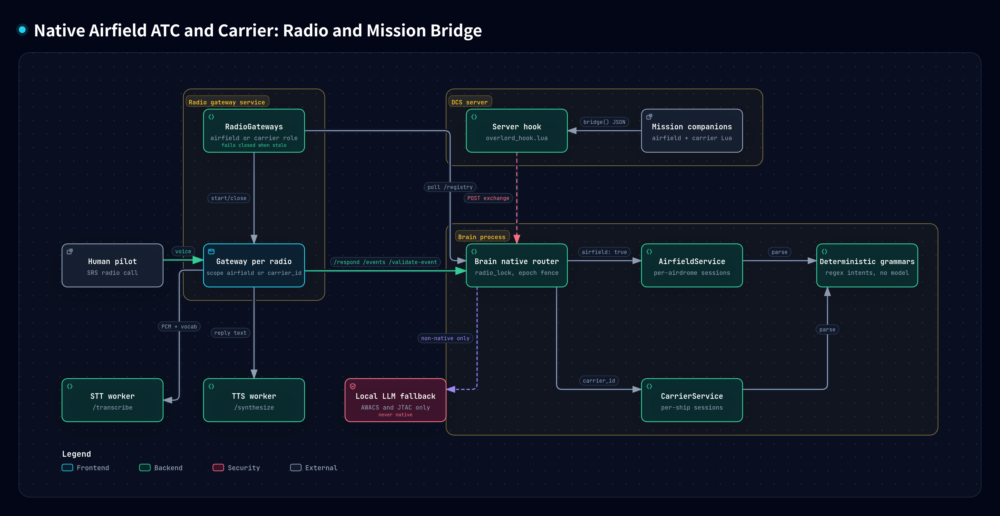

Airfield ATC Departure: Normal Procedure

[Open interactive view](https://neboman11.github.io/overlordbot-local/diagrams/airfield-departure-phases.html)

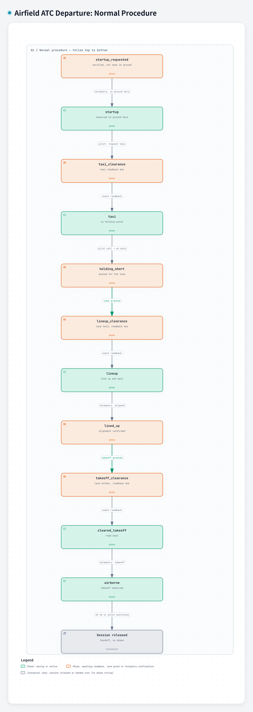

Airfield ATC Departure: Runway Crossing and Return to Parking

[Open interactive view](https://neboman11.github.io/overlordbot-local/diagrams/airfield-departure-crossing-parking.html)

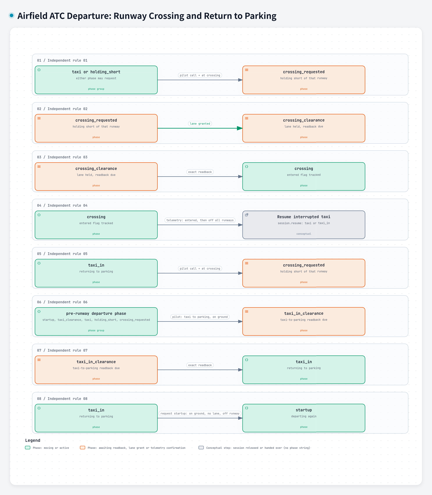

Airfield ATC Departure: Clearance Revocations and Aborts

[Open interactive view](https://neboman11.github.io/overlordbot-local/diagrams/airfield-departure-revocations.html)

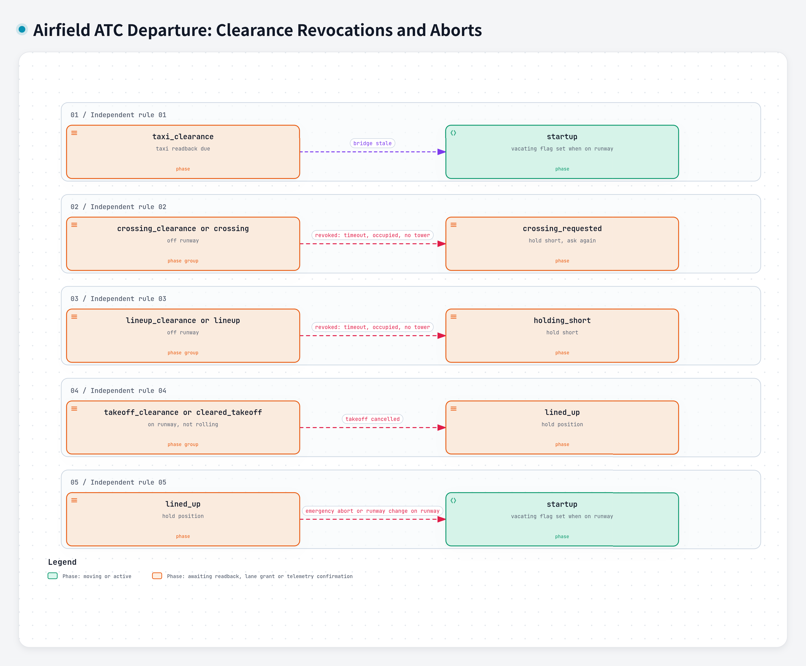

Airfield ATC Departure: Early Closure and Uncleared Take-off

[Open interactive view](https://neboman11.github.io/overlordbot-local/diagrams/airfield-departure-closure.html)

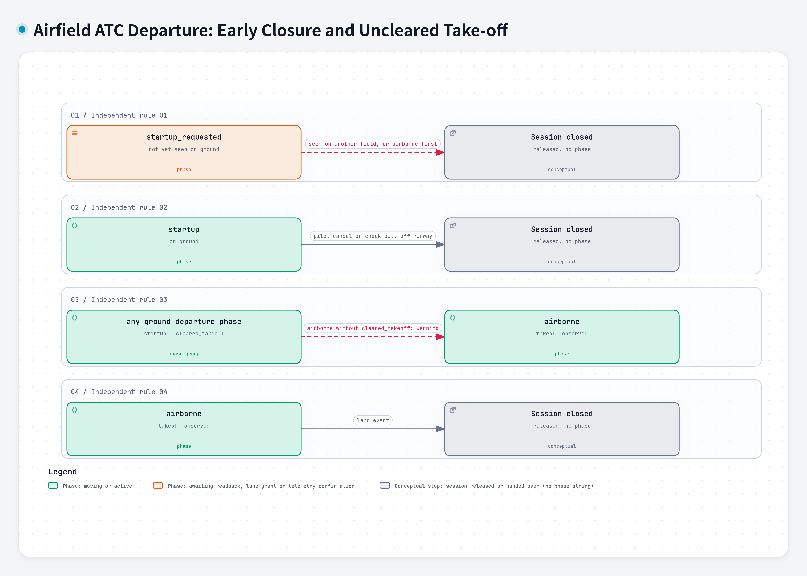

Airfield ATC Arrival: Normal Procedure (published pattern)

[Open interactive view](https://neboman11.github.io/overlordbot-local/diagrams/airfield-arrival-phases.html)

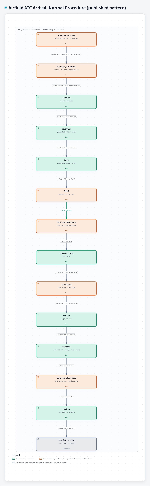

Airfield ATC Arrival: Straight-in, Go-around, Touch-and-go and Re-brief

[Open interactive view](https://neboman11.github.io/overlordbot-local/diagrams/airfield-arrival-variants.html)

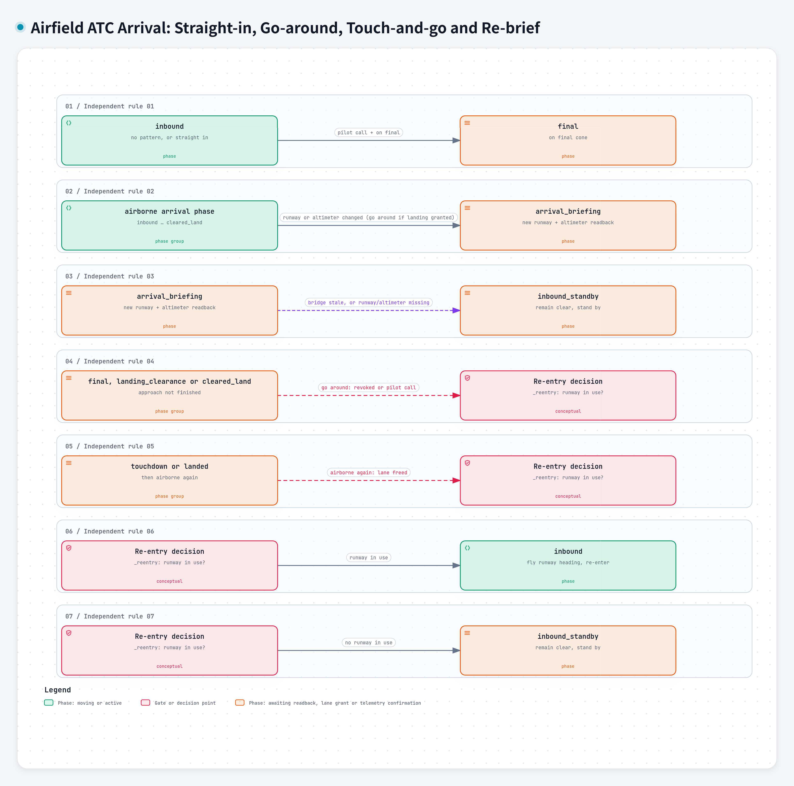

Airfield ATC Arrival: Grounded Samples, Landing Elsewhere, Cancellation and Handover

[Open interactive view](https://neboman11.github.io/overlordbot-local/diagrams/airfield-arrival-exceptions.html)

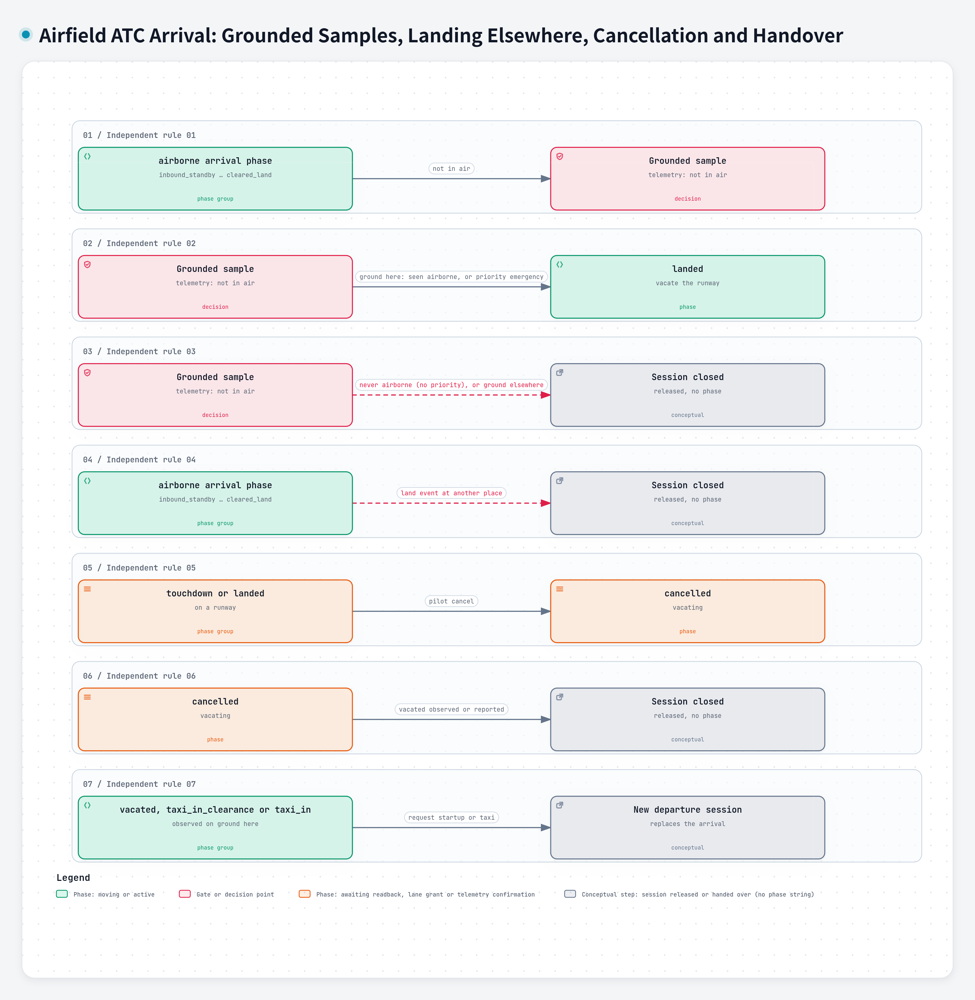

Carrier Recovery: CASE I Normal Procedure

[Open interactive view](https://neboman11.github.io/overlordbot-local/diagrams/carrier-recovery-phases.html)

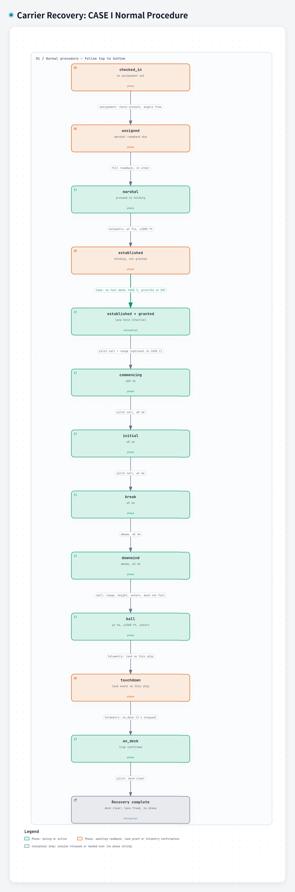

Carrier Recovery: CASE I, II and III Pattern Calls

[Open interactive view](https://neboman11.github.io/overlordbot-local/diagrams/carrier-recovery-case-variants.html)

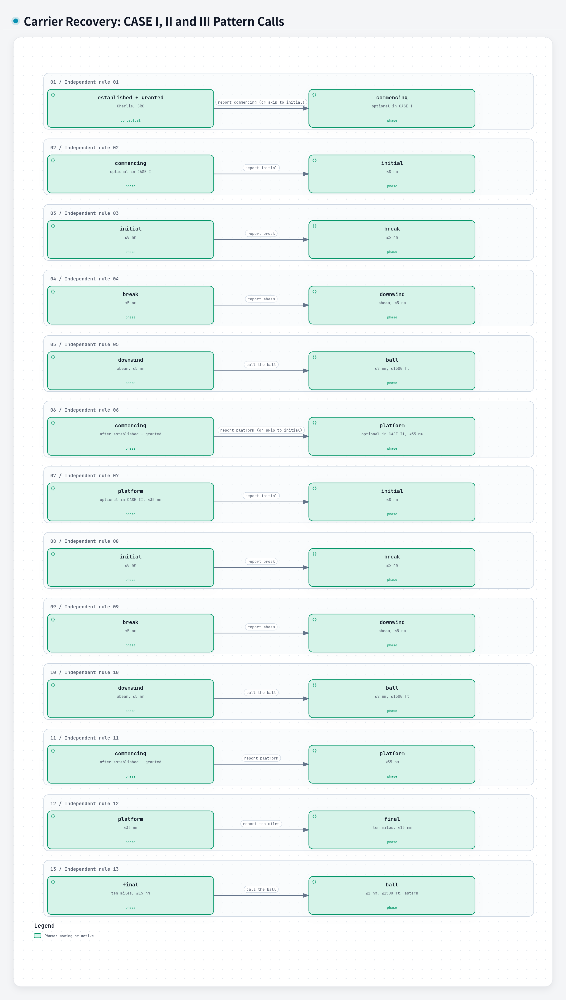

Carrier Recovery: Bolter, Wave-off and Foul Deck

[Open interactive view](https://neboman11.github.io/overlordbot-local/diagrams/carrier-recovery-recycle.html)

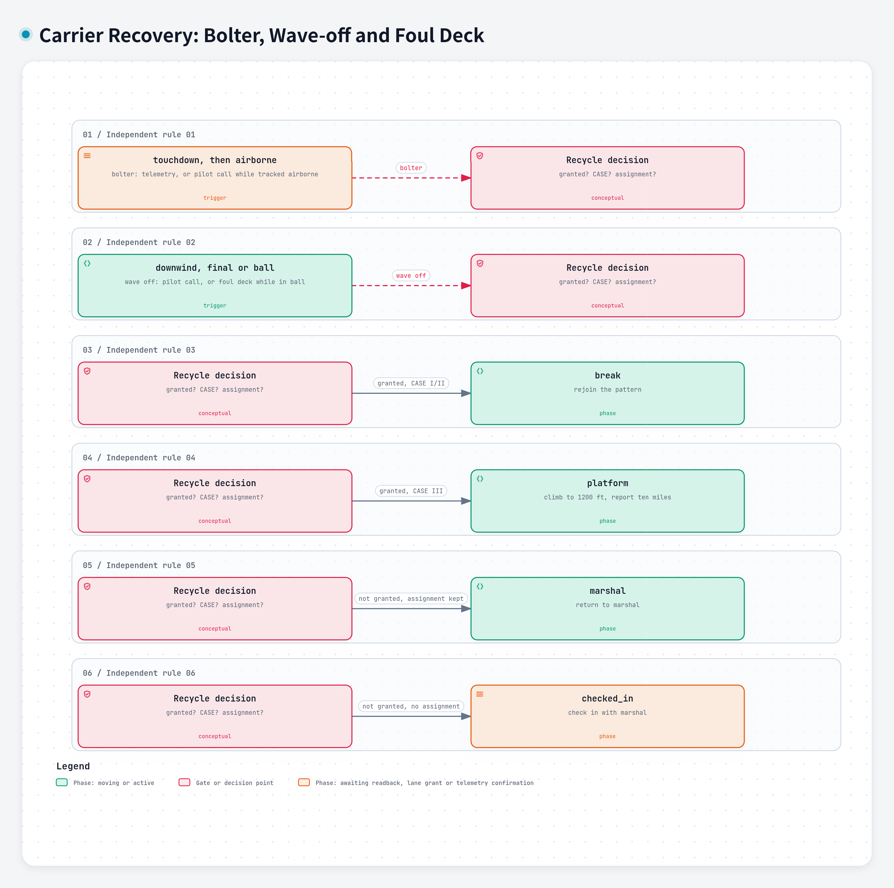

Carrier Recovery: Reassignment, Stale Bridge and Closure

[Open interactive view](https://neboman11.github.io/overlordbot-local/diagrams/carrier-recovery-exceptions.html)

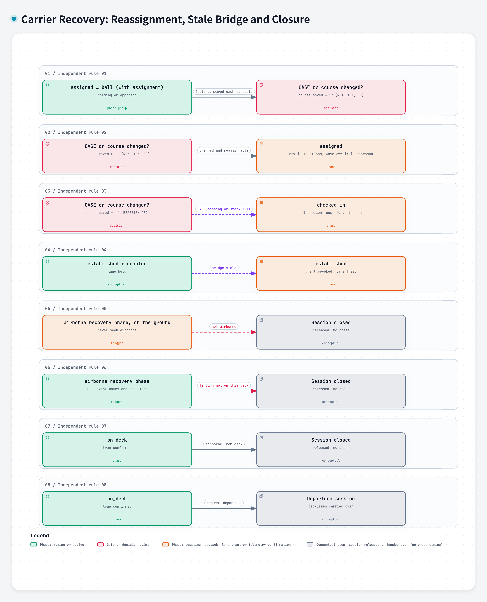

Carrier Departure Phases (session.phase)

[Open interactive view](https://neboman11.github.io/overlordbot-local/diagrams/carrier-departure-phases.html)

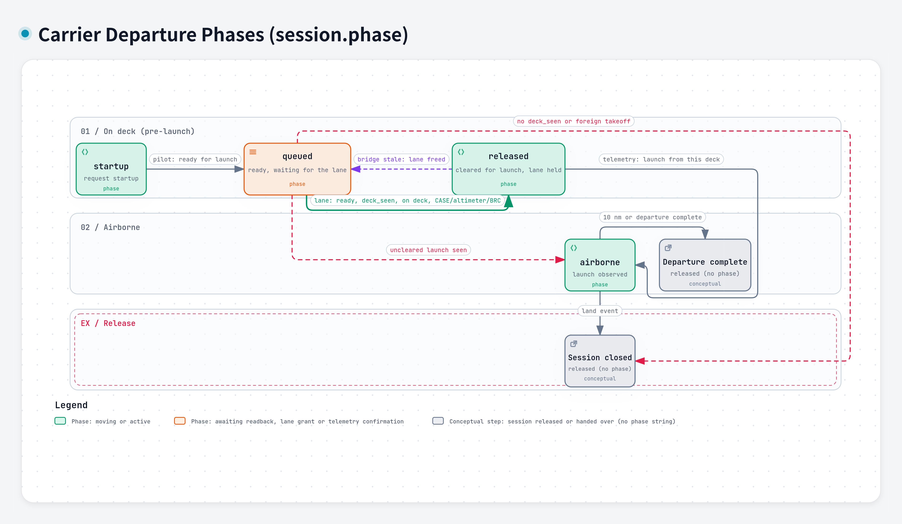

Native Session Ownership and Isolation Safeguards

[Open interactive view](https://neboman11.github.io/overlordbot-local/diagrams/native-session-safeguards.html)

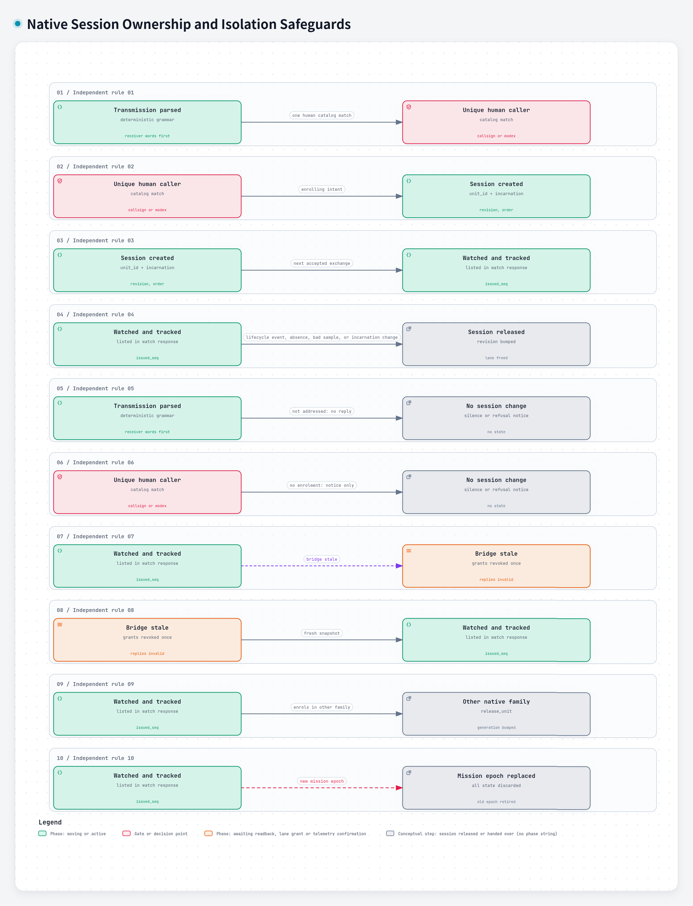

